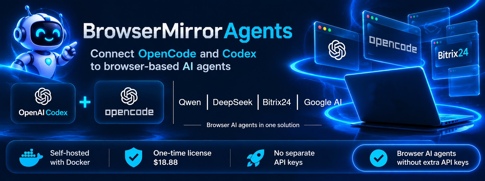

# BrowserMirrorAgents

**OpenCode ve Codex'i tarayıcı tabanlı AI ajanlarına bağlayın.**

BrowserMirrorAgents, AI kodlama araçlarını tarayıcı tabanlı AI hizmetlerine bağlayan kendi kendine barındırılan bir entegrasyon katmanıdır.

Mevcut tarayıcı oturumları aracılığıyla Bitrix24, Qwen ve DeepSeek ile favori AI kodlama ortamınızı kullanın — her sağlayıcı için ayrı API anahtarları satın almanıza gerek yok.

[🌐 Resmi Web Sitesi](https://agent.p5g.ru/)

---

## 🚀 Desteklenen Entegrasyonlar

### AI Kodlama Araçları

| Entegrasyon | Durum |
|---|---|
| OpenCode | Destekleniyor |
| Codex | Destekleniyor |

### Tarayıcı Tabanlı AI Sağlayıcıları

| Sağlayıcı | Destek |
|---|---|
| Bitrix24 | Destekleniyor |
| Qwen | Destekleniyor |
| DeepSeek | Destekleniyor |
| Google AI | Destekleniyor |

---

## ✨ Neden BrowserMirrorAgents?

- **Ayrı API anahtarları yok** — bireysel API erişimi satın almak yerine tarayıcı oturumlarını kullanın.
- **Birden fazla AI sağlayıcısı** — farklı tarayıcı tabanlı AI hizmetlerine bağlanın.
- **OpenCode entegrasyonu** — OpenCode iş akışınızda tarayıcı tabanlı AI ajanlarını kullanın.
- **Codex entegrasyonu** — Codex'i desteklenen tarayıcı AI hizmetlerine bağlayın.
- **Kendi kendine barındırılan** — uygulamayı kendi sunucunuzda çalıştırın.
- **Docker dağıtımı** — Docker Compose kullanarak basit kurulum.
- **Tek seferlik ödeme** — yinelenen abonelik yok.

## 🔌 Nasıl Çalışır

BrowserMirrorAgents, AI kodlama araçları ile tarayıcı tabanlı AI hizmetleri arasında bir entegrasyon katmanı olarak hareket eder.

1. BrowserMirrorAgents'ı sunucunuza dağıtın.
2. Tarayıcı tabanlı AI oturumlarınızı bağlayın.
3. OpenCode veya Codex'i yapılandırın.
4. Desteklenen AI sağlayıcılarıyla çalışmaya başlayın.

Gerçek erişiminiz, kullanım limitleriniz ve kullanılabilirliğiniz ilgili AI sağlayıcısına ve tarayıcı oturumunuza bağlıdır.

---

## 🐳 Kurulum

Docker kullanarak BrowserMirrorAgents'ı dağıtın.

`YOUR_LICENSE_KEY` ifadesini satın alma sonrası aldığınız kişisel lisans anahtarınızla değiştirin.

`docker run -d --name browsermirroragents --restart unless-stopped -p 8000:8000 -e LICENSE_KEY=YOUR_LICENSE_KEY soft.p5g.ru/browsermirroragents:latest`

Konteyner çalıştıktan sonra açın:

**[http://localhost:8000](http://localhost:8000)**

Bu kadar! BrowserMirrorAgents kullanıma hazır.

---

## 💳 Fiyatlandırma

### $18.88 — Tek seferlik ödeme

- Tek seferlik lisans satın alma
- Aylık abonelik yok
- Yinelenen ödeme yok
- Kendi kendine barındırılan dağıtım

[Lisansınızı Alın](https://agent.p5g.ru/)

## 🌍 Çok Dilli Destek

BrowserMirrorAgents 21 dili destekler:
- [English](../../README.md)
- [Español](../es/README.md)
- [Deutsch](../de/README.md)
- [Français](../fr/README.md)
- [Italiano](../it/README.md)
- [简体中文](../zh_CN/README.md)
- [繁體中文](../zh_TW/README.md)
- [Português (Brasil)](../pt_BR/README.md)
- [日本語](../ja/README.md)
- [한국어](../ko/README.md)
- [العربية](../ar/README.md)
- [हिन्दी](../hi/README.md)
- [Türkçe](README.md)
- [Bahasa Indonesia](../id/README.md)
- [Polski](../pl/README.md)
- [Tiếng Việt](../vi/README.md)
- [ไทย](../th/README.md)
- [Nederlands](../nl/README.md)
- [Svenska](../sv/README.md)
- [Norsk](../no/README.md)
- [Русский](../ru/README.md)

## 🤖 AI Destekli Arayüz İzleme

**Arayüz değişiklikleri konusunda endişelenmeyin. Biz sizin için izliyoruz.**

AI destekli izleme tarafımızda çalışır, desteklenen AI hizmetlerinde ve tarayıcı arayüzlerindeki değişiklikleri takip eder.

Arayüz öğeleri veya seçiciler değiştiğinde, sistemimiz güncellemeleri algılar ve yenilenmiş seçiciler ile uyumluluk ayarlamalarını neredeyse anında yayınlar.

- **Sürekli izleme** — desteklenen arayüzler düzenli olarak izlenir.
- **AI destekli tespit** — değişiklikler otomatik olarak tanımlanır.
- **Hızlı güncellemeler** — yenilenmiş seçiciler ve arayüz ayarlamaları hızla yayınlanır.
- **Daha az bakım** — arayüz değişikliklerini manuel olarak takip etmenize veya seçicileri sürekli olarak kendiniz güncellemenize gerek yok.

**Biz arayüzleri izliyoruz. Siz işinize odaklanın.**

## 💬 Topluluk ve Destek

Bu depo, BrowserMirrorAgents ile ilgili sorunları bildirmek, sorunları tartışmak ve çözümleri paylaşmak için merkezi bir yerdir.

Şunlara davetlisiniz:

- **Hata bildirimi** — beklenmeyen davranış veya hatalarla karşılaşırsanız issue oluşturun.
- **Özellik isteği** — iyileştirmeler ve yeni entegrasyonlar önerin.
- **Çözümleri tartışın** — diğer kullanıcılarla fikirler, geçici çözümler ve çözümler paylaşın.
- **Sorular sorun** — yapılandırma, uyumluluk ve kullanım hakkında tartışın.
- **Güncellemeleri takip edin** — düzeltmeler, iyileştirmeler ve uyumluluk değişiklikleri hakkındaki tartışmaları takip edin.

Yeni bir issue oluşturmadan önce, kopyalardan kaçınmak için lütfen mevcut issue'ları kontrol edin.

**Bir sorun mu buldunuz? Bir issue açın ve birlikte çözelim!**

---

## ❓ SSS

### Ayrı API anahtarlarına ihtiyacım var mı?

Hayır. BrowserMirrorAgents mevcut tarayıcı oturumları üzerinden çalışacak şekilde tasarlanmıştır, bu nedenle desteklenen her sağlayıcı için ayrı API anahtarları satın almanıza gerek yoktur.

### Hangi AI kodlama araçları desteklenir?

OpenCode ve Codex.

### Hangi AI sağlayıcıları desteklenir?

Bitrix24, Qwen, DeepSeek, Google AI.

### Kendi sunucumda barındırabilir miyim?

Evet. BrowserMirrorAgents bir Docker imajı olarak dağıtılır ve Docker Compose kullanılarak dağıtılabilir.

### Aylık ücretler var mı?

Hayır. BrowserMirrorAgents tek seferlik lisans satın alma ile mevcuttur.

### AI hizmetleri sınırsız mı?

Kullanım, her AI sağlayıcısının kullanılabilirliğine, politikalarına ve limitlerine ve tarayıcı oturumlarınıza bağlıdır.

Ayrıca ilgili sağlayıcıların hizmet şartlarına tabi olarak birden fazla tarayıcı hesabı bağlayabilir ve oturumlar arasında geçiş yapabilirsiniz.

---

## 🔗 Bağlantılar

- **Web sitesi:** https://agent.p5g.ru/
- **Lisans:** Resmi web sitesinde mevcut.
- **Destek:** İletişim bilgileri resmi web sitesinde mevcuttur.

---

## ⚖️ Sorumluluk Reddi

BrowserMirrorAgents bağımsız bir yazılım ürünüdür ve OpenAI, OpenCode, Bitrix24, Alibaba Cloud, DeepSeek veya ilgili sahipleriyle bağlantılı, onaylanmış veya resmi olarak ilişkili değildir.

Tüm üçüncü taraf ürün adları ve ticari markalar ilgili sahiplerine aittir.

Üçüncü taraf AI hizmetlerinin kullanımı, ilgili hizmet şartlarına, politikalara ve kullanım sınırlamalarına tabidir.

---

**BrowserMirrorAgents**

*Bir entegrasyon katmanı. Birden fazla tarayıcı tabanlı AI ajanı.*
